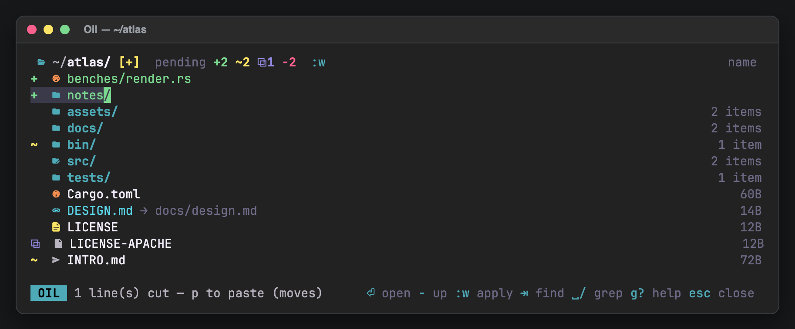
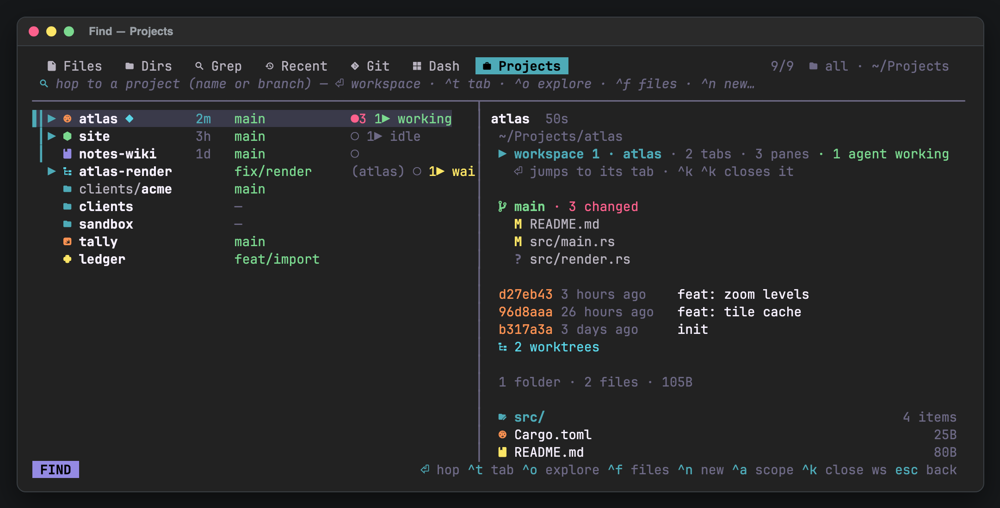

# herdr-oil

An [oil.nvim](https://github.com/stevearc/oil.nvim)-style file explorer and a
fuzzy finder for [herdr](https://herdr.dev), in a popup like herdr-hop.

**Project page:** <https://christineecker.github.io/herdr-oil/> (screens,
an interactive model of the buffer → plan rules, keys, source).

[](https://christineecker.github.io/herdr-oil/)

The directory listing **is a text buffer**. Edit it with vim keys, then `:w`:
herdr-oil diffs the buffer against the disk, shows the plan, and applies it.

| you do                                  | herdr-oil does          |
|-----------------------------------------|-------------------------|
| change a line (`cw`, `cin`, `A`…)       | rename                  |
| `o` + `name` / `name/` / `a/b/c.txt`     | create file / dir / nested |
| `dd`                                    | delete (to Trash)       |
| `dd`, go elsewhere (`-`, `⏎`), `p`       | move                    |
| `yy`, `p`, edit the name                | copy                    |
| `yy` or `dd`, then `gm` / `gc`          | move / copy to a fuzzy-picked folder |
| `link -> new/target` / `o` + `name -> target` | retarget / create a symlink |
| `:%s/IMG_(\d+)\.jpeg/photo_$1.jpg/`     | batch rename (live preview while typing) |
| `:%s/^/{03#}_/` · `:recipe kebab`        | number names 001, 002… · named rename recipes |
| `:g/\.bak$/d` · `:v/\.md$/d`             | delete lines matching / not matching |

Edits in several directories are kept and applied together. Swaps (`a`↔`b`),
case-only renames on APFS, "move the child out, delete the parent" and
"rename a dir while editing inside it" are handled. Nothing is ever
overwritten; clashes are reported before anything runs, and flagged on
the line (`! ✗ already exists`) while you type.

The finder (`⇥` from the explorer, or its own key) is one prompt. It opens
on **All**: files and folders from one walk, and while the query is empty the
Dash rows (pending edits, changes, marked and recent files). A first character
picks another source and stays in front of the query as its sigil: `/` grep,
`@` projects, `+` git changes, `<` recent (`/fn main` greps for `fn main`).
None of these start an fzf term, so `'exact`, `^prefix` and `!not` still work.
A row above it lists the sources (the current one in its colour), the
count (`N of M` while filtering, `N to triage`, `N hits`), root and
non-default flags. The prompt is the sigil, the query (empty: a noun saying
what to type) and the branch on the right. Pause two seconds on an empty
prompt and it lists the sigils too. The list and the preview each get a
one-line heading: what is listed and how many; the file's git letter, name,
size and age, with `+N −M` for a change.
The footer is a `FIND` badge, the position (`3 of 40 · 2 marked`) and at
most two keys for the selected row (`⏎ focus workspace · ^t tab`,
`⏎ diff · ^a unstage`, `^s send 3`) plus `esc back` and `? keys`. A pane
under 12 rows keeps just the prompt and the list. `⌫` on an empty query goes back to All; `␣`
there opens a menu of every source (`a f d g r s p h`, the same letters as
the explorer's `␣` keys) and `?` one sheet with the sources, every key for
the current source, the view keys and the query syntax; `⇥` jumps to the next group: the next file in grep, the next section in Dash,
the next folder elsewhere. The sources:
**Files** and **Dirs** (parallel walk honouring `.gitignore`, nucleo fuzzy
matching, fzf query syntax), **Grep** (live ripgrep), **Recent** (files you
opened through herdr-oil), **Git** (changed and untracked files across the
whole repository; `⏎` opens the diff view, `^a` stages, `alt-d` discards) and
**Dash** (pending edits, git changes, marked and recent files in one list) and
**Projects** (every project under your roots, recent hops first, like
[herdr-hop](../herdr-hop): `⏎` focuses the workspace open there or creates one).
Previews use `bat` when installed and render off the UI thread. Folder previews
show counts, sizes and the README; archives (`zip`, `tar.*`), SQLite schemas,
binary plists and PDFs (`pdfinfo` / `pdftotext`, else `mdls`) are described
instead of "binary file".

Git is part of the listing: status letters tell staged (green), unstaged
(yellow) and both (peach) apart, renames show as `R`, the header carries the
branch with `↑ahead ↓behind`, `]g` / `[g` jump between changed entries, `gG`
lists only those, and `:stage` / `:unstage` / `:restore` work on ranges. The
**diff view** (`gD`, `d` in the viewer, `⏎` in the Git tab) is GitHub-style:
numbered lines, tinted additions and removals with word-level highlights,
syntax colour, hunk headers, folds that expand (`z` / `Z`), unified or split
(`s`, automatic from 160 columns), a file pane with `+a −d` stats and viewed
marks (`v`), and three comparisons (`c`: working tree, staged, unstaged).

While you edit, renamed lines show where they came from (`final.md ← draft.md`),
and a footer names what the directory will lose on `:w`; the review dialog
highlights just the characters a rename changes.

## Install

```sh
herdr plugin link /path/to/herdr-oil      # builds with cargo
```

Bind the actions in `~/.config/herdr/config.toml`, then `herdr server reload-config`:

```toml
[[keys.command]]
key = "prefix+d"
type = "plugin_action"
command = "herdr-oil.explorer"

[[keys.command]]
key = "prefix+shift+f"
type = "plugin_action"
command = "herdr-oil.finder"

[[keys.command]]
key = "prefix+slash"
type = "plugin_action"
command = "herdr-oil.grep"
```

Actions: `explorer`, `finder` (All), `grep`, `recent`, `git`, `projects`. Each opens the popup at the
focused pane's working directory.

## Projects

`␣p`, `:projects` or the `projects` action. Reads herdr-hop's `config.toml`
(`roots`, `max_depth`, `recent_limit`, `default_root`, `default_branch`) and
shares its `recent.tsv`, so hopping from either plugin ranks the same; a
`[projects]` table in herdr-oil's config overrides any of these (and
`recent_file`). Without herdr-hop the defaults are `~/Projects`, depth 2.



`▎` recent · `▶` open workspace · stack icon · time since the hop · branch
(peach when detached, `(repo)` for linked worktrees) · `●N` changed /
`↑N` unpushed / `○` clean (recent and open rows) · agents. `◆` after the
name marks the project oil was opened in. Branch names are searchable. The preview shows the
workspace, branch with upstream, changed files, the last commits,
worktrees, then the folder and its README.

| key | does |
|---|---|
| `⏎` | jump to the workspace and tab open on the project, else `herdr workspace create --cwd --label --focus` |
| `^t` | open as a tab in the current workspace |
| `^o` `^f` `alt-g` | explore it in oil · find files in it · grep in it |
| `^n` | new project named by the query: `default_root/name`, `git init -b`, README, first commit, then hop |
| `^a` | scope: all → open → dirty (changes or unpushed) → recent |
| `^x` `^k ^k` | forget from recent · close its workspace, or only its tab when other projects share the workspace (never both) |

## Opening files

`⏎` follows `open` in the config. The default `view` shows the file inside the
oil window: syntax-highlighted, scrollable (`j k ␣ b ^d ^u g G`), `e` edits it
in `$EDITOR` inside the popup, `q` goes back. A preview pane sits next to the
listing by default (`^p` toggles it).

With `open = "auto"`, `$EDITOR file` is typed into the pane you came from when
it sits at a shell prompt, otherwise a split opens to its right. Agents are
never typed into, and names with control characters are never typed at all.
Explicit keys, from the listing or the viewer:

| key  | target |
|------|--------|
| `^v` | split right (`exec $EDITOR`, the split closes with the editor) |
| `^x` | split below |
| `^t` | new herdr tab |
| `^e` | inside the popup; you return to the explorer afterwards |
| `gx` / finder `^g` | system opener |

Line numbers from grep are passed as `+N` (vim, nvim, nano, micro, emacs, kak),
`file:N` (helix, zed, subl) or `-g file:N` (VS Code family).

## Keys

`g?` in the popup shows everything; `/` there filters the list (`/chmod`,
`/send`, `/git`). Highlights:

| explorer | |
|---|---|
| `⏎` `-` `_` `~` | view file / enter dir · parent · start dir · home |
| `:w` `^s` `ZZ` | review & apply · apply and quit |
| `q` `esc` | close (asks first when edits are unsaved; esc cancels a pending key first) |
| `u` `^r` `.` | undo · redo (per directory) · repeat the last change |
| `U` `:undo-apply` | roll back the last `:w` (moves go home, Trash comes back, new entries go to Trash); `U` again redoes. Permanent deletes can't come back, and an apply that only deleted permanently leaves nothing to undo |
| `ge` `:edit-buffer` | edit the listing in `$EDITOR` (`/001 name` tags keep identity, like oil.nvim); back in the explorer with the edits staged |
| `gi` `:'<,'>send` | type the path(s) into the origin pane, no Enter (`@path` for agents, quoted for shells) |
| `H` `L` | back · forward through visited folders |
| `m{a-z}` `'{a-z}` `:marks` | mark the folder · jump to a mark (kept across sessions) · list marks |
| `:%s/pat/rep/[gi]` | regex rename over a range (`%`, `'<,'>`, `n,m`, default the cursor line); `$1` or `\1` groups; the buffer previews it as you type |
| `V…` then `I` / `A` / `:` | prefix · suffix (before the extension) · any range command on the selection |
| `:prefix x` `:suffix x` | same on the cursor line or a range |
| `:chmod +x` `:%chmod 644` | change permissions; applies immediately, not on `:w` |
| `gm` `gc` | after a yank (`yy`, `V…y`): move / copy the yanked entries to a folder picked in the finder (`⏎` picks a folder, a file means its folder, `^n` uses the query as a new sub-folder); after a cut (`dd`) only `gm`. Shown in the `g` menu only while something is yanked; the review dialog follows |
| `g.` `gs` `gS` `gd` `^p` | hidden · sort · reverse sort · sizes/details/off · preview |
| `gy` `gY` `gn` | copy path relative to the repo (or start dir) · absolute path · file name |
| `:cd p` `:touch a b` `:mkdir d` `:sort mtime` `:sort!` `:e!` | `⇥` completes commands, `:cd` / `:e` paths, `:sort` / `:chmod` / `:recipe` arguments and listed names after `:s/` and `:touch` |
| `↑` `↓` `^p` `^n` in `:` / `/` | history, filtered by what is typed; kept across sessions |
| `^a` `^e` `^w` `^u` `^k` `alt-b` `alt-f` | readline editing, the same in `:`, `/`, the viewer prompt and the finder |
| `/pat` `:noh` | search; matches stay highlighted until `:noh` |
| `{#}` `{03#}` `{#10}` `{#0+5}` | counters in `:s` replacements and `:prefix` / `:suffix` (per match, in buffer order); `\{` is a literal brace |
| `:g/pat/d` `:v/pat/d` `:g/pat/s/a/b/` | act on lines matching (or not) a regex; the lines to delete are struck through while you type |
| `:recipe NAME` | `kebab` `snake` `slugify` `lower` `upper` `title` `clean` `screenshots`, plus your own from the config |
| `:w` review dialog | `j` `k` pick an op, `x` drops it, `o` jumps to its line; clashes on `:w` offer `c` (number them: `report 2.pdf`) and `o` |
| `:history` | applied batches (kept across sessions); `u` reviews undoing an older one |
| `:plan-copy` `:plan > file` | the pending plan as text, to the clipboard or a file |
| `:extract` `:zip a.zip` `:tar a.tgz` | unpack into a new folder (links, `..` and absolute members refused) · pack the cursor line or a range |
| `]g` `[g` `gG` `gD` `gl` | next / previous changed entry · only changed entries · diff view · `git log` |
| `:stage` `:unstage` `:restore` | on the line or a range; `:restore` asks first |
| `gd` | sizes → perms · size · age → owner · perms · xattrs (`@`) · broken links → off |
| `gw` | parent-folder column (wide popups); click a header path segment to jump there |
| `⇥` `␣␣` `␣a` `:find` · `␣f` `␣g` `␣d` `␣r` `␣s` `␣p` `␣h` | finder: all · files · grep · dirs · recent · git changes · projects · dashboard |

| viewer (`⏎` on a file) | |
|---|---|
| `j` `k` `␣` `b` `^d` `^u` `g` `G` | scroll |
| `/pattern` `n` `N` | search the file, next / previous hit |
| `d` | the diff view (starts on from the Git tab and for deleted files); a gutter marks changed lines in the plain view |
| `L` | `git log --graph` of the file |
| `p` `P` | send the path (with `:line` of the current hit) · send the lines around it as text |
| `e` | edit in `$EDITOR` inside the popup, back to the viewer after |
| `^v` `^x` `^t` `o` `y` | split right · below · tab · system app · copy path |
| `q` `esc` | back to the listing or finder |

| diff view | |
|---|---|
| `j` `k` `␣` `b` `g` `G` | move the cursor |
| `]c` `[c` · `⇥` `⇧⇥` | next / previous hunk · file |
| `s` `w` | unified ⇄ split · ignore whitespace |
| `z` `Z` | 20 more lines of context · the whole file |
| `v` `c` | mark viewed (on to the next file) · compare working tree / staged / unstaged |
| `⏎` `e` `^v` `^x` `^t` | open the editor at the cursor's line |
| `p` `P` | send `path:line` · send the hunk (agents get a bracketed paste; for a shell it goes to the clipboard) |
| `h` `l` `/` `n` `N` `^l` `d` | scroll sideways · search · reload · back to the plain file |

| finder | |
|---|---|
| `/` `@` `+` `<` typed first | switch to grep · projects · git changes · recent (from All or Files) |
| `␣` `?` on an empty query | menu of sources: `a` all · `f` files · `d` folders · `g` grep · `r` recent · `s` changes · `p` projects · `h` dash |
| `⌫` on an empty query | back to All, then to the explorer |
| `⇥` `⇧⇥` | next · previous group (grep: file · Dash: section · otherwise folder); picking a move/copy target: files ⇄ folders |
| `^o` | reveal the selection in the explorer |
| `^space` | mark files or grep hits (each hit keeps its line); `⏎` opens them all, `^s` sends them |
| `^r` | root: cwd → repository root → parent |
| `alt-h` `alt-i` `alt-p` | hidden · ignored · preview |
| `^y` `^g` | copy path · system opener |
| `foo -- *.rs -t py -T md` | grep: limit to globs / ripgrep file types |
| `^s` | send the selection (or marked files, grep hits with `:line`) to the origin pane |
| `alt-s` | send the grep lines themselves (`path:line: text`) to an agent |
| Git tab: `⏎` `^a` `alt-d` | diff view of every change · stage ⇄ unstage · discard (asks) |

Vim support: counts, `h j k l w b e W B E 0 ^ $ gg G f F t T ;`, operators
`d c y` with motions and text objects `iw aw iW aW`, plus `in`/`an` for the
file-name stem and extension (`cin` renames `report.md` keeping `.md`),
`x X s S C D r J ~ p P o O i a I A`, visual line mode, `/` search with `n N`.

## Config

`$(herdr plugin config-dir herdr-oil)/config.toml`, see
[`config.example.toml`](config.example.toml): editor, open target, trash vs
permanent delete, hidden files, details, preview, icons, git status, confirm,
stay-open, ignore rules, finder cap, diff layout, rename recipes. The diff
tints blend into `background` from herdr's `[theme.custom]` (default
`#222222`) and need a truecolor terminal (`$COLORTERM`).

## CLI

```sh
herdr-oil [DIR|FILE]          # explore (FILE: its dir, cursor on it)
herdr-oil --finder | --files | --grep | --recent | --git | --dash | --projects
herdr-oil --pick              # print chosen file(s) instead of opening
```

## Development

```sh
cargo test        # planner, apply engine (on temp dirs), vim engine, finder, parsers
cargo build --release
```

Layout: `buffer.rs` (lines with hidden ids) · `vim.rs` (modal editing) ·
`input.rs` (shared line editing) · `plan.rs` (buffer diff → ops + validation) ·
`apply.rs` (staged execution) · `archive.rs` (`:extract` / `:zip`) ·
`entry.rs` (listing, git status) · `git.rs` (staging, log, show) ·
`diff.rs` (unified diff parser, word diff, rows) · `diffview.rs` (diff view) ·
`finder.rs` (nucleo + ignore + rg) · `projects.rs` (index, hop, herdr workspaces) · `preview.rs` (bat/ANSI, worker thread) ·
`open.rs` (editor hand-off) · `launch.rs` (herdr CLI) · `ui.rs` · `app.rs`.

## Project page

Live at <https://christineecker.github.io/herdr-oil/>, served by GitHub
Pages from `docs/index.html` (Settings → Pages → Deploy from branch →
`main` / `/docs`), a self-contained overview: screens, interactive model of
the buffer → plan rules, keys, source. Rebuild it after code changes with
`python docs/src/build_page.py` (runs `cargo test` for the test list; the
screens are ANSI captures from `herdr pane read --format ansi` in
`docs/src/shots/`). The README images come from the same captures:
`python docs/src/readme_shots.py` (headless Chrome and a Nerd Font).

## Acknowledgements

herdr-oil exists because of [oil.nvim](https://github.com/stevearc/oil.nvim)
by Steven Arcangeli. The central idea comes from oil: the directory listing is
an ordinary editable buffer where every line carries a hidden entry id, and
saving diffs that buffer against the disk and asks before applying creates,
renames, moves, copies and deletes. Key choices like `-` for the parent
directory and `g.` for hidden files follow oil too.

herdr-oil is an independent Rust reimplementation for herdr popups, not a
port. No oil.nvim code is used. Please star and support the original.
